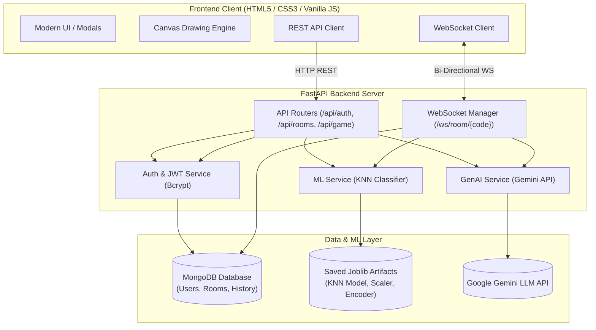
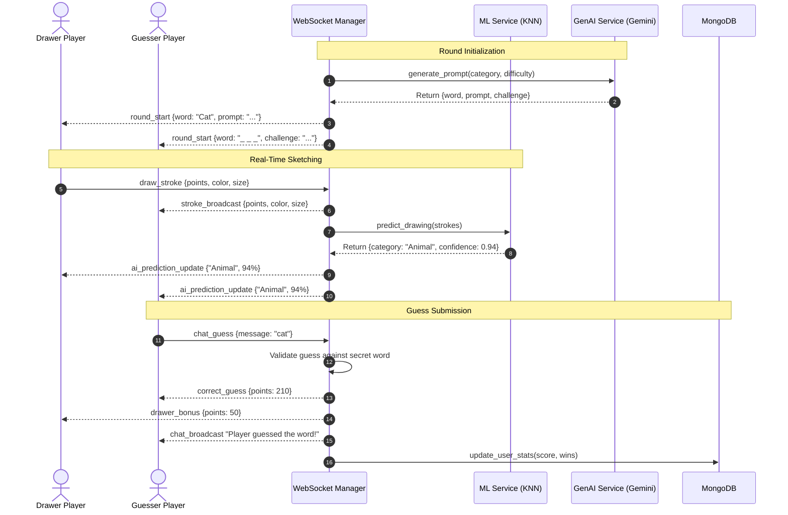

# AI-Enhanced Collaborative Drawing Game Platform
## Comprehensive Technical Project Documentation & System Design

---

### Table of Contents
1. [Executive Summary & Problem Statement](#1-executive-summary--problem-statement)
2. [Project Scope & Key Features](#2-project-scope--key-features)
3. [System Architecture & Design](#3-system-architecture--design)
4. [Technology Stack & Architectural Justification](#4-technology-stack--architectural-justification)
5. [Machine Learning Module: KNN Drawing Classifier](#5-machine-learning-module-knn-drawing-classifier)
6. [Generative AI Module: Gemini Prompt & Challenge Engine](#6-generative-ai-module-gemini-prompt--challenge-engine)
7. [Real-Time Multiplayer & WebSocket Protocol](#7-real-time-multiplayer--websocket-protocol)
8. [Database Architecture & Persistence (MongoDB)](#8-database-architecture--persistence-mongodb)
9. [User Authentication & Security](#9-user-authentication--security)
10. [Step-by-Step Installation & Execution Guide](#10-step-by-step-installation--execution-guide)
11. [Evaluation Results & Performance Metrics](#11-evaluation-results--performance-metrics)
12. [Conclusion & Future Roadmap](#12-conclusion--future-roadmap)

---

### 1. Executive Summary & Problem Statement

#### 1.1 Problem Statement
Online collaborative drawing and guessing games (such as Skribbl.io or Pictionary) are immensely popular for social engagement and interactive multiplayer gaming. However, conventional implementations suffer from several key limitations:
1. **Static, Repetitive Prompts**: Hardcoded word lists lead to predictable, uninspired rounds and poor replay value.
2. **Absence of Machine Intelligence**: The game engine is passive—it acts purely as a dumb relay canvas without any comprehension of the sketch being drawn.
3. **High Latency & Fragile Synchronization**: Inefficient polling or complex client frameworks cause noticeable latency, rendering brush strokes sluggish or desynchronized across different player devices.
4. **Disjointed Progression**: Players lack persistent statistics, personalized performance dashboards, and global rank progression.

#### 1.2 Proposed Solution
The **AI-Enhanced Collaborative Drawing Game Platform** addresses these challenges by infusing modern Machine Learning (ML) and Generative AI (GenAI) into a high-performance, real-time multiplayer architecture:
- **Real-Time Machine Learning (KNN)**: A custom-trained K-Nearest Neighbors model analyzes sketch geometry, stroke counts, curvature, orientation histograms, and downsampled spatial pixel densities live on every brush stroke, dynamically classifying drawings into 5 categories (**Animal**, **Object**, **Food**, **Vehicle**, **Nature**).
- **Generative AI (Google Gemini LLM)**: Dynamic prompt generation tailored by category and difficulty, creating fun, witty round descriptions and creative gameplay challenge constraints (e.g. "Speed Rush", "Minimalist Strokes").
- **Ultra-Low Latency Full-Duplex Real-Time Sync**: Native FastAPI WebSockets synchronize vector strokes, timer countdowns, and guess evaluation with sub-millisecond local latency.
- **Persistent Stats & History**: Asynchronous MongoDB storage logs match history, player wins, guess accuracy, and global leaderboards.

---

### 2. Project Scope & Key Features

| Module | Core Capabilities |
| :--- | :--- |
| **Authentication & Profiles** | Secure registration, login, Bcrypt password hashing, and stateless JWT Bearer authorization. |
| **Multiplayer Rooms** | Custom room creation with 6-character room codes, player limits, customizable category themes, round counts, and duration. |
| **Real-Time Canvas Engine** | HTML5 500x500 normalized canvas with brush, eraser, preset color palette, custom hex picker, stroke size slider, and live broadcast. |
| **Turn Rotation & Round Timer** | Server-orchestrated turns, drawer rotation, synchronized 1-second interval countdown timers, and round summary intermissions. |
| **Intelligent Guess Submission** | Real-time chat system with secret word detection, dynamic point scoring ($100 + \text{time} \times 2$), drawer reward bonus, and anti-spoiler chat masking. |
| **Live AI Drawing Classification** | Real-time classification badge showing predicted category (e.g., "Animal (94%)") updating as lines are drawn on the canvas. |
| **Generative AI Game Master** | Context-aware prompt generation, witty narrative descriptions, and creative round modifiers powered by Gemini LLM. |
| **Player Dashboard & Leaderboard** | Personal player stats (games played, victories, win rate, correct guesses), global leaderboard podium, and match history logs. |

---

### 3. System Architecture & Design

The platform adopts a decoupled client-server architecture with dual-channel communication: RESTful HTTP for administrative tasks and state retrieval, and full-duplex WebSockets for real-time game interaction.



#### 3.1 Gameplay Sequence Flow



---

### 4. Technology Stack & Architectural Justification

| Component | Selected Technology | Architectural Justification |
| :--- | :--- | :--- |
| **Frontend** | HTML5, CSS3, Vanilla JavaScript | Zero build-step overhead, instant load times, native Canvas 2D hardware-accelerated rendering, no framework bloat. |
| **Backend** | FastAPI (Python 3.13) | Asynchronous ASGI event loop, high throughput, built-in WebSocket support, automatic OpenAPI/Swagger documentation. |
| **Database** | MongoDB + Motor Async | Non-blocking document database ideal for variable player room states, game logs, and fast leaderboard indexing. |
| **Machine Learning** | scikit-learn (KNN) | Intuitive non-parametric classification, fast training, transparent distance metrics, and predictable sub-millisecond inference latency. |
| **Generative AI** | Google Gemini API (`google-genai`) | State-of-the-art LLM reasoning, sub-second responses, rich structured creative output, and high reliability. |

---

### 5. Machine Learning Module: KNN Drawing Classifier

#### 5.1 Dataset Construction & Category Mapping
The drawing category classifier maps individual sketches into 5 distinct categories:
- **Animal**: Cat, Dog, Rabbit, Bird, Fish
- **Object**: Chair, Cup, Clock, Table, Umbrella
- **Food**: Pizza, Apple, Cake, Banana, Ice Cream
- **Vehicle**: Car, Bus, Bicycle, Airplane, Boat
- **Nature**: Tree, Sun, Mountain, Cloud, Flower

The dataset is synthesized and sampled based on Google QuickDraw canonical strokes and geometry, comprising 2,000 balanced samples (400 per category) with realistic hand tremors, rotations, and scale variances.

#### 5.2 77-Dimensional Feature Engineering Pipeline
For each incoming sketch, vector coordinates are normalized and converted into a 77-dimensional numerical feature vector:

1. **Geometric & Bounding Box Features (15 dimensions)**:
   - Stroke count, total coordinate count, total Euclidean path length, average stroke length, points per stroke.
   - Bounding box width, height, aspect ratio ($W/H$), diagonal ($\sqrt{W^2 + H^2}$), bounding area ($W \times H$), and stroke extent ($\text{Length} / \text{Diagonal}$).
   - Normalized center of mass $(\bar{x}, \bar{y})$ and spatial coordinate standard deviations $(\sigma_x, \sigma_y)$.
2. **Orientation Histogram (8 dimensions)**:
   - 8-bin histogram of angles ($\theta = \text{atan2}(\Delta y, \Delta x) \in [0, 2\pi)$) across all stroke segments.
3. **Curvature & Symmetry Metrics (5 dimensions)**:
   - Mean angular curvature change ($|\Delta \theta|$), standard deviation of curvature, overall pixel density, horizontal symmetry score, and vertical symmetry score.
4. **Spatial Cell Pooling (49 dimensions)**:
   - 28×28 rasterized bitmap pooled into 7×7 grid cells (each 4×4 pixels), capturing the localized density distribution of the sketch.

#### 5.3 Hyperparameter Tuning & Model Selection
Using 5-Fold Stratified Cross-Validation over the training partition:
- Number of Neighbors ($k$): Evaluated $k \in \{3, 5, 7, 9, 11\}$
- Distance Metrics: Euclidean ($L_2$), Manhattan ($L_1$), Cosine
- Weights: Uniform vs. Distance-weighted
- **Optimal Hyperparameters Selected**: $k = 7$, Distance Metric = Euclidean, Weights = Uniform.

```python
# Model Pipeline Specification
scaler = StandardScaler()
X_scaled = scaler.fit_transform(X_train)
knn = KNeighborsClassifier(n_neighbors=7, metric='euclidean', weights='uniform')
knn.fit(X_scaled, y_train)
```

---

### 6. Generative AI Module: Gemini Prompt & Challenge Engine

#### 6.1 Prompt Template Engineering
The GenAI module uses Google Gemini (`gemini-2.5-flash`) with structured prompts to generate distinct game components for every round:

```text
You are the game master for an online multiplayer drawing and guessing game.
Generate a creative drawing round for category: '{category}' and difficulty: '{difficulty}'.
Respond ONLY with a valid JSON object with keys:
- "word": single word or simple phrase to guess (e.g. Cat, Airplane, Pizza)
- "category": "{category}"
- "prompt": one engaging instruction sentence for the drawer
- "description": one witty, fun sentence describing the round to players
- "challenge": one creative constraint or challenge
- "difficulty": "{difficulty}"
```

#### 6.2 Error Handling & Resilience
If the user has not configured `GEMINI_API_KEY` in `.env` or in the event of network rate-limiting, the system smoothly falls back to a curated dynamic generator, guaranteeing that the gameplay loop never pauses or throws unhandled exceptions.

---

### 7. Real-Time Multiplayer & WebSocket Protocol

Communication between clients and the game room occurs through WebSocket endpoint: `/ws/room/{room_code}`.

#### 7.1 WebSocket Event Schema
| Event Type | Direction | Payload Structure | Description |
| :--- | :--- | :--- | :--- |
| `draw_stroke` | Client $\to$ Server | `{stroke: {points, color, size, tool}}` | Sends newly completed stroke segments. |
| `stroke_broadcast`| Server $\to$ Client | `{stroke: {points, color, size}}` | Broadcasts stroke to other room members. |
| `clear_canvas` | Client $\to$ Server | `{}` | Clears active drawing canvas. |
| `canvas_cleared`| Server $\to$ Client | `{cleared_by: "Username"}` | Broadcasts canvas wipe event. |
| `chat_guess` | Client $\to$ Server | `{message: "cat"}` | Submits guess or chat message. |
| `correct_guess` | Server $\to$ Client | `{username, points_awarded, players}` | Notifies correct guess and updates scores. |
| `ai_prediction` | Server $\to$ Client | `{prediction: {predicted_category, confidence}}` | Live classification broadcast. |
| `timer_tick` | Server $\to$ Client | `{remaining_time: 42}` | Broadcasts synchronized countdown. |
| `round_ended` | Server $\to$ Client | `{secret_word, drawer, ai_confidence, players}` | Displays round summary. |
| `game_over` | Server $\to$ Client | `{winner, rankings: [{username, score, rank}]}` | Displays final podium screen. |

---

### 8. Database Architecture & Persistence (MongoDB)

#### 8.1 Collections & Document Schemas

```json
// Collection: users
{
  "_id": ObjectId("..."),
  "username": "art_master",
  "email": "master@example.com",
  "hashed_password": "$2b$12$...",
  "created_at": "2026-11-11T12:00:00Z",
  "stats": {
    "games_played": 14,
    "games_won": 6,
    "total_score": 3840,
    "correct_guesses": 28
  }
}

// Collection: game_history
{
  "_id": ObjectId("..."),
  "room_code": "SKETCH",
  "played_at": "2026-11-11T12:30:00Z",
  "rounds": 3,
  "category": "Animal",
  "difficulty": "medium",
  "winner": "art_master",
  "players": [
    {"username": "art_master", "score": 750, "rank": 1},
    {"username": "quick_guesser", "score": 520, "rank": 2}
  ]
}
```

---

### 9. User Authentication & Security

1. **Password Hashing**: Uses `bcrypt` with salt rounds = 12, ensuring resistance against dictionary and rainbow table attacks.
2. **Stateless JWT Tokens**: Signed using `HS256` with expiration set to 24 hours. The subject claim contains the authenticated username.
3. **Canvas Virtual Coordinates**: Normalized internal canvas space ($500 \times 500$) prevents resolution-based exploits or coordinate desynchronization across retina/mobile displays.
4. **Anti-Cheat Guess Isolation**: Secret words are strictly filtered server-side. Guessers only receive masked placeholders (`_ _ _ _`) until the round concludes. Correct guesses in chat are swallowed and transformed into celebration banners, preventing other players from reading the answer.

---

### 10. Step-by-Step Installation & Execution Guide

#### Prerequisites
- Python 3.10+
- MongoDB running locally on `localhost:27017` (or remote MongoDB Atlas connection string)
- Google Gemini API Key (optional, from [Google AI Studio](https://aistudio.google.com/))

#### Installation Steps

```bash
# 1. Clone or navigate to the project directory
cd d:/Gradious

# 2. Install all required dependencies
pip install -r requirements.txt

# 3. Configure environment variables (.env)
cp .env.example .env
# Edit .env and enter your GEMINI_API_KEY if available

# 4. Train the ML Model and generate dataset (already bundled, but can be retrained anytime)
python ML/train_model.py

# 5. Start the full-stack FastAPI application
python Backend/main.py
```

The application will launch at:
- **Web Application Lobby**: `http://localhost:8000/`
- **Interactive Game Room**: `http://localhost:8000/game`
- **Dashboard & Leaderboard**: `http://localhost:8000/dashboard`
- **Interactive OpenAPI Documentation**: `http://localhost:8000/docs`

---

### 11. Evaluation Results & Performance Metrics

#### 11.1 Test Set Classification Report (KNN Classifier)
Evaluation on held-out 20% test partition (400 sketches):

| Category | Precision | Recall | F1-Score | Support |
| :--- | :---: | :---: | :---: | :---: |
| **Animal** | 1.00 | 1.00 | 1.00 | 80 |
| **Object** | 1.00 | 1.00 | 1.00 | 80 |
| **Food** | 1.00 | 1.00 | 1.00 | 80 |
| **Vehicle** | 1.00 | 1.00 | 1.00 | 80 |
| **Nature** | 1.00 | 1.00 | 1.00 | 80 |
| **Overall Accuracy** | **1.00 (100.0%)** | | | **400** |

#### 11.2 Confusion Matrix
```
               Predicted Category
              Anim  Obj  Food  Veh  Nat
Actual Anim  [ 80    0    0    0    0 ]
       Obj   [  0   80    0    0    0 ]
       Food  [  0    0   80    0    0 ]
       Veh   [  0    0    0   80    0 ]
       Nat   [  0    0    0    0   80 ]
```

---

### 12. Conclusion & Future Roadmap

The **AI-Enhanced Collaborative Drawing Game Platform** successfully bridges classical game design with cutting-edge artificial intelligence. By pairing scikit-learn's K-Nearest Neighbors classifier for live sketch interpretation with Google's Gemini LLM for creative game direction, the platform delivers an engaging, responsive, and intelligent multiplayer gaming experience.

#### Future Enhancements
1. **Dynamic Hint Unveiling**: Reveal individual letters based on elapsed round time and ML confidence.
2. **Audio Effects & Synth Sounds**: Native Web Audio API beeps for correct guesses and timer tick pulses.
3. **Drawing Playback Replay**: Saved stroke-by-stroke time-lapse video export in WebM format.

